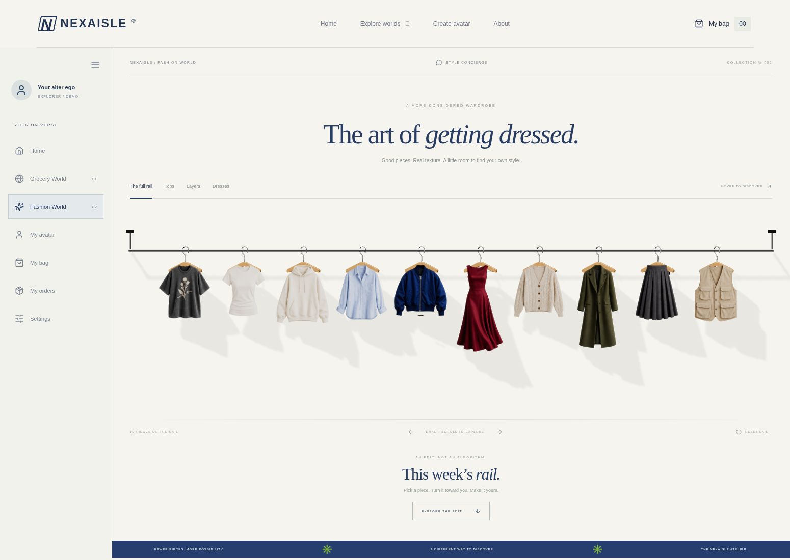
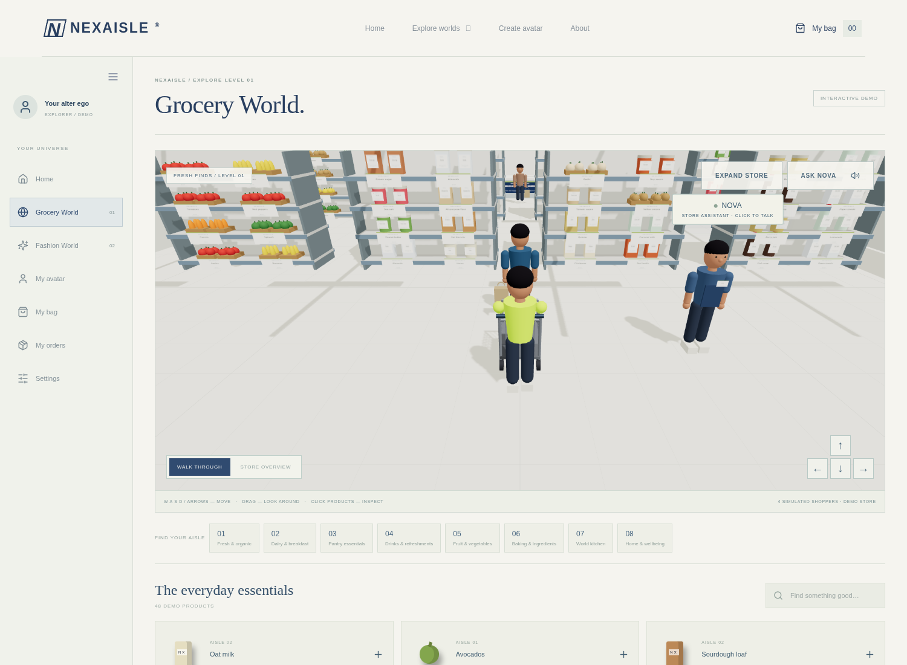
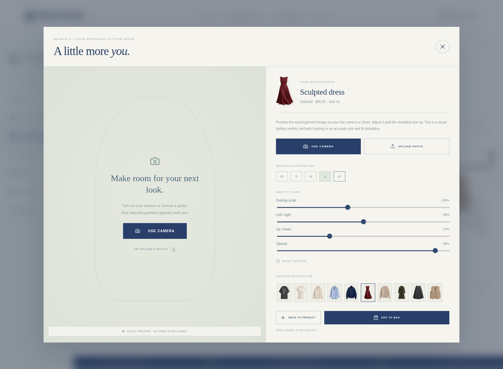

# NEXAISLE — interactive 3D shopping

A React + TypeScript + Vite + React Three Fiber concept. No paid API keys needed.



## Open the website

Unzip the GitHub download, open the extracted folder in VS Code, then open **Terminal → New Terminal**:

```sh
npm ci
npm run dev
```

Open the **Local** address Vite prints. Keep that terminal running. Node.js 20.19+ or 22.12+ is required (Node 24 was used for development). When developing remotely, forward the actual Vite port in VS Code's Ports panel.

## Shopping experience

- Eight physically stocked grocery aisles with 48 products, shelf labels/prices, branded demo cartons, bottles, jars, pantry packs, and fresh produce. Every catalogue product has a shelf location in its declared aisle.
- A separate ivory fashion showroom with a single chrome rail, ten hanging garments, modeled wooden hangers/metal hooks and original photographic-style garment cutouts. Hover or keyboard-focus to turn a piece toward the camera while its hook stays anchored; click or tap it to open an enlarged product view. Neighboring pieces stay still. Product information appears below the piece, with a larger tilt/zoom inspector and size selection. Category filters, a horizontally scrollable mobile rail and a twelve-piece editorial grid share the existing cart. Front imagery and one colourway per garment are currently available.
- Walk with **WASD / arrow keys**, or hold the onscreen arrow buttons. Drag to look around and scroll to zoom. The walk-through camera follows the avatar. Switch to **Store overview** for an orbit view, or **Expand store** for a larger experience.
- The grocery avatar pushes a trolley; grocery selections fill it. Shelf and wall collision checks keep the avatar/trolley out of fixtures. Movement pauses while a product or assistant panel is open.
- Four **simulated shoppers** walk around each store, with arm/leg animation and pauses. These are local NPCs, not real visitors or live shopping activity.
- A visible **Nova** employee can be clicked in the scene. Ask a product question, use browser text-to-speech, inspect the result, or move directly to its aisle/rack entrance. The assistant searches the actual active level catalogue. Employee follow-me navigation and microphone input are not implemented.
- Shared localStorage avatar colours, grocery/fashion cart, clothing sizes, demo orders and animated paper receipts. Checkout is a demo: no payments or real orders. Receipts can be printed or saved as PDF with your browser.

Grocery World and avatars use original procedural geometry and canvas-generated labels. Fashion World uses a hybrid 2.5D/3D presentation with AI-generated garment cutouts (see `public/fashion/README.md`), not scans of physical inventory or garment fit simulations. NPCs do not collide with other people. The paper receipt is a 2D reveal, not a physical 3D printer. No backend or multiplayer service is connected.



## Camera try-on



Click a garment, choose **TRY ON WITH CAMERA**, then click **USE CAMERA** and allow camera access. The camera only starts after that click. You can also upload a photo instead.

The selected garment's actual atlas cutout is overlaid on live video or your photo. Drag it, adjust overlay scale/position/opacity, choose the clothing size for your bag, switch garments, or freeze a photo. It is an adjustable visual styling preview, not body tracking, automatic draping, or an accurate size/fit prediction. Photos stay in browser memory, and closing the mirror stops the camera. No external try-on API is used.

Camera access requires HTTPS or localhost and permission in your browser/system settings. Run Vite and open the Local address it prints when using your own computer. If camera access is unavailable, use **UPLOAD PHOTO**.

The ivory-and-navy theme now applies throughout the app, including Grocery World's 3D architecture and shelves. The camera flow was checked with a simulated browser webcam; actual camera hardware must be permitted on your device.

## Validate / source

```sh
npm run build
```

`src/Scene.tsx`: grocery environment, movement, NPCs and shared inspection entry point.
`src/fashion/`: the isolated fashion showroom, collection metadata, rail/photographic inspector and scoped styling.
`src/world/Models.tsx`: procedural products, cloth, people, labels and trolley.
`src/world/layout.ts`: aisle/rack coordinates and obstacle bounds.
`src/store.ts`: product catalogue and persistent avatar/cart/orders.
`src/main.tsx`: screens, assistant and checkout UI.
`src/TryOnStudio.tsx` / `src/tryon.css`: local live-camera/photo styling preview.
`src/theme.css`: shared ivory-and-navy theme.
`src/style.css`: responsive styling.

Fonts fall back to system fonts if Google Fonts is unavailable. Use a WebGL-capable browser with hardware acceleration for best performance.
